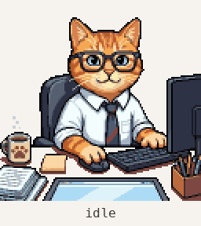
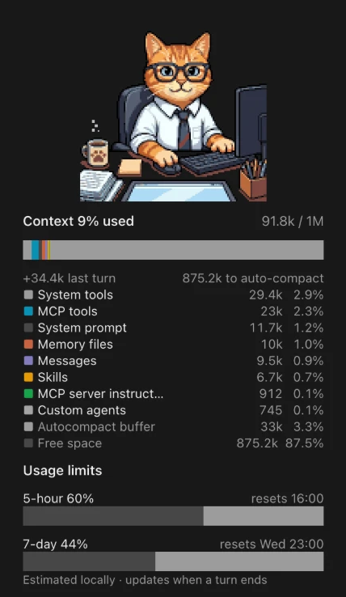

# Som the office cat

[](LICENSE) [](CHANGELOG.md) [](#install) [ภาษาไทย](#ส้ม-แมวออฟฟิศ-ภาษาไทย)

A Claude Code mod: a pane beside the chat where Som, a pixel office cat in glasses, acts out what Claude is doing, with your session's context, usage limits and cost underneath.

<p>

&nbsp;

</p>

```
/plugin install som-the-office-cat --marketplace SarawuthS/som-the-office-cat
```

Tried on a subscription account (macOS) and an Enterprise account (Windows). Details in [Install](#install).

## What it shows

- **Som's poses** follow the session: `think` (thought bubble), `read` (magnifier, for Read/Grep/Glob/WebFetch/WebSearch), `edit` (keys and code light up, for Edit/Write), `bash` (terminal on the tablet), `done` (happy eyes and sparkles for 8 s after a turn ends), then `idle`. While working Som looks at the monitor, types and moves the mouse. Som blinks and the coffee steams in every pose.
- **Context:** % of the window used, tokens / window, a bar that stretches with the pane (each category in its colour, the autocompact buffer, free space), tokens added by the last turn, distance to auto-compact, and one row per category. The header turns amber at 70 % and red at 85 %.
- **Usage limits** (subscription accounts): 5-hour and 7-day % with reset times. Hidden when your account reports none.
- **Session cost:** what this session has cost so far at API list prices, the same figure as `/cost`. On a subscription plan this is not what you are billed, and the pane says so. Hidden where the host keeps no figure.
- **Monthly spend** (accounts with extra usage, e.g. Team or Enterprise): this month's spend against its cap, with a bar. Hidden when your account reports none.

The context figures and session cost are a local estimate (no model tokens), refreshed at session start and whenever a turn ends. For Monthly spend the mod asks Claude's own usage endpoint (`api.anthropic.com/api/oauth/usage`) at the same moments, through Claude Code's sign-in: the mod never sees your credential, and it sends nothing else anywhere. That endpoint is not documented and could change; when it answers nothing usable (no first-party sign-in, such as Bedrock, Vertex or a gateway, extra usage off, or a changed answer), the row is not drawn.

The picture needs the Claude desktop app (or another surface that draws SVG); in a terminal the pane shows the statistics only.

## Install

At the prompt of a Claude Code terminal session:

```
/plugin install som-the-office-cat --marketplace SarawuthS/som-the-office-cat
```

Answer `y` to add the marketplace, then pick a scope (user scope loads it in every session). From a shell:

```
claude plugin install som-the-office-cat --marketplace SarawuthS/som-the-office-cat
```

In the desktop app, where `/plugin` does not run: click **+** next to the prompt box, then **Plugins**, **Add marketplace** with `SarawuthS/som-the-office-cat`, then **Add plugin**.

The pane opens when a session starts; if it does not, type `/som-the-office-cat`.

## Develop

- `hooks/register.tsx` — hooks, state and the pane. `types/index.d.ts` — the state contract.
- `hooks/sprite.ts` — generated SVG layers. Regenerate from `assets/office-cat.png` with `python3 tools/build_sprite.py [--debug <dir>]` (needs Pillow); change the overlays in the script, not `sprite.ts`.
- `hooks/pane.test.tsx` — mounts the pane on every surface with seeded statistics.
- `tools/make_demo_gif.py` — renders `assets/demo.gif` from the same layers the pane draws (needs Pillow and Playwright).
- `assets/office-cat.png` — Som's original picture, made with an AI image tool.

```
claude plugin validate .
claude plugin test .
npx -p typescript tsc -p .
```

`tsc` needs the API types, which Claude Code writes into `.claude-plugin/types/` (ignored by git) when it loads the mod from this folder. CI runs `validate` and `test` on every push.

Run a working copy with `claude --plugin-dir <this folder>`.

## Troubleshooting

- **No pane.** Type `/som-the-office-cat`. If the command is unknown, check the plugin is installed and enabled (`claude plugin list`), then start a new session.
- **No cat, only numbers.** The picture draws in the desktop app; a terminal shows the statistics only.
- **An update does not arrive.** Run `claude plugin marketplace update som-the-office-cat`, then `claude plugin update som-the-office-cat@som-the-office-cat`, and restart Claude. Installs follow the `version` in `plugin.json`, so a release always raises it.
- **No Usage limits.** Only subscription accounts have 5-hour/7-day windows; accounts without them (such as Enterprise) can show Monthly spend instead.
- **No Monthly spend.** It needs a first-party sign-in with extra usage turned on, and appears after the first turn ends. Bedrock, Vertex and gateway logins never show it.

Notes from building it, in case you change the pane: Box sizes are character cells, not pixels; the pane accepts only whole-number `%` widths and `flexGrow` up to 10000, and one refused prop drops the whole pane; keep the total SVG markup small (about 110k characters draws, 430k did not); changing an interactive `Svg`'s `source` reloads its frame and flickers, so every pose stays mounted and only `display` changes; layers must centre in the same row or they drift apart.

## License

MIT, for the code and for Som's picture alike. See [LICENSE](LICENSE). Changes are listed in [CHANGELOG.md](CHANGELOG.md).

---

# ส้ม แมวออฟฟิศ (ภาษาไทย)

mod สำหรับ Claude Code: pane ข้างแชทที่มี "ส้ม" แมวออฟฟิศพิกเซลใส่แว่น ขยับท่าตามสิ่งที่ Claude กำลังทำ และแสดงสถิติ context, usage limits และค่าใช้จ่ายของ session ไว้ด้านล่าง

<p>

&nbsp;

</p>

ทดสอบแล้วกับบัญชี subscription (macOS) และบัญชี Enterprise (Windows)

## สิ่งที่แสดง

- **ท่าของส้ม** เปลี่ยนตาม session: `think` (ฟองความคิด), `read` (แว่นขยาย เมื่อใช้ Read/Grep/Glob/WebFetch/WebSearch), `edit` (คีย์บอร์ดกับโค้ดสว่างขึ้น เมื่อใช้ Edit/Write), `bash` (จอ terminal บนแท็บเล็ต), `done` (ยิ้มตาปิดพร้อมประกายดาว 8 วินาทีหลังจบ turn) แล้วกลับเป็น `idle` ระหว่างทำงานส้มจะมองจอ พิมพ์คีย์บอร์ด และเลื่อนเมาส์ ทุกท่าส้มกะพริบตาและมีไอลอยจากแก้วกาแฟ
- **Context:** % ที่ใช้ไปของ context, จำนวน token เทียบทั้งหมด, แถบที่ยืดตามความกว้างของ pane (แต่ละหมวดตามสี, autocompact buffer, พื้นที่ว่าง), token ที่เพิ่มในรอบล่าสุด, ระยะที่เหลือก่อน auto-compact และตารางแยกตามหมวด หัวข้อเปลี่ยนเป็นสีเหลืองที่ 70% และสีแดงที่ 85%
- **Usage limits** (บัญชีแบบ subscription): % ที่ใช้ไปของรอบ 5 ชั่วโมงและ 7 วัน พร้อมเวลารีเซ็ต ถ้าบัญชีไม่มีข้อมูลนี้ส่วนนี้จะถูกซ่อน
- **Session cost:** ค่าใช้จ่ายของ session นี้จนถึงตอนนี้ตามราคา API ปกติ เป็นตัวเลขเดียวกับ `/cost` สำหรับบัญชี subscription นี่ไม่ใช่ยอดที่ถูกเรียกเก็บจริง และ pane จะบอกไว้ใต้ตัวเลข ถ้าไม่มีตัวเลขนี้จะถูกซ่อน
- **Monthly spend** (บัญชีที่เปิด extra usage เช่น Team หรือ Enterprise): ยอดใช้จ่ายของเดือนนี้เทียบกับวงเงิน พร้อมแถบแสดง ถ้าบัญชีไม่มีข้อมูลนี้จะถูกซ่อน

สถิติ context และ Session cost เป็นค่าประมาณที่คำนวณในเครื่อง (ไม่ใช้ token ของโมเดล) อัปเดตตอนเริ่ม session และทุกครั้งที่ turn จบ ส่วน Monthly spend นั้น mod จะถาม endpoint การใช้งานของ Claude เอง (`api.anthropic.com/api/oauth/usage`) ในจังหวะเดียวกัน ผ่านการ sign-in ของ Claude Code โดยที่ mod ไม่เห็น credential ของคุณ และไม่ส่งข้อมูลอื่นไปที่ไหน endpoint นี้ไม่มีในเอกสารและอาจเปลี่ยนได้ ถ้าตอบกลับมาใช้ไม่ได้ (ไม่ได้ sign-in กับ Anthropic โดยตรง เช่น ใช้ Bedrock, Vertex หรือ gateway, ไม่ได้เปิด extra usage หรือรูปแบบคำตอบเปลี่ยน) แถวนี้จะไม่แสดง

ภาพแมวต้องใช้แอป Claude Desktop (หรือ surface อื่นที่วาด SVG ได้) ใน terminal จะเห็นเฉพาะสถิติ

## ติดตั้ง

ในช่องพิมพ์ของ Claude Code แบบ terminal:

```
/plugin install som-the-office-cat --marketplace SarawuthS/som-the-office-cat
```

ตอบ `y` เพื่อเพิ่ม marketplace แล้วเลือก scope (user scope จะโหลดในทุก session) หรือจาก shell:

```
claude plugin install som-the-office-cat --marketplace SarawuthS/som-the-office-cat
```

ในแอป Desktop ซึ่งใช้ `/plugin` ไม่ได้: กด **+** ข้างช่องพิมพ์ → **Plugins** → **Add marketplace** ใส่ `SarawuthS/som-the-office-cat` → **Add plugin**

pane จะเปิดเองเมื่อเริ่ม session ถ้าไม่เปิด ให้พิมพ์ `/som-the-office-cat`

## พัฒนาต่อ

- `hooks/register.tsx`: hook, state และการวาด pane ส่วน `types/index.d.ts` คือ contract ของ state
- `hooks/sprite.ts`: ชั้นภาพ SVG ที่สร้างอัตโนมัติ สร้างใหม่จาก `assets/office-cat.png` ด้วย `python3 tools/build_sprite.py [--debug <dir>]` (ต้องมี Pillow) ถ้าจะแก้ท่า ให้แก้ในสคริปต์ ไม่ใช่ใน `sprite.ts`
- `hooks/pane.test.tsx`: วาด pane บนทุก surface ด้วยสถิติจำลอง
- `tools/make_demo_gif.py`: สร้าง `assets/demo.gif` จากชั้นภาพชุดเดียวกับที่ pane วาด (ต้องมี Pillow และ Playwright)
- `assets/office-cat.png`: ภาพต้นฉบับของส้ม สร้างด้วยเครื่องมือสร้างภาพ AI

```
claude plugin validate .
claude plugin test .
npx -p typescript tsc -p .
```

`tsc` ต้องใช้ไฟล์ type ของ API ซึ่ง Claude Code เขียนไว้ใน `.claude-plugin/types/` (git ไม่เก็บโฟลเดอร์นี้) ตอนโหลด mod จากโฟลเดอร์นี้ ส่วน CI จะรัน `validate` และ `test` ทุกครั้งที่ push

รันสำเนาที่กำลังแก้ด้วย `claude --plugin-dir <โฟลเดอร์นี้>`

## แก้ปัญหา

- **ไม่มี pane:** พิมพ์ `/som-the-office-cat` ถ้าไม่รู้จักคำสั่งนี้ ให้เช็คว่าติดตั้งและเปิดใช้ plugin แล้ว (`claude plugin list`) แล้วเริ่ม session ใหม่
- **ไม่มีแมว มีแต่ตัวเลข:** ภาพแมววาดได้เฉพาะในแอป Desktop ใน terminal จะเห็นแค่สถิติ
- **อัปเดตแล้วไม่ได้ของใหม่:** รัน `claude plugin marketplace update som-the-office-cat` ตามด้วย `claude plugin update som-the-office-cat@som-the-office-cat` แล้วเปิด Claude ใหม่ การติดตั้งดูจาก `version` ใน `plugin.json` ทุก release จึงต้องเพิ่มเลขเวอร์ชัน
- **ไม่มี Usage limits:** มีเฉพาะบัญชี subscription ที่มีรอบ 5 ชั่วโมงและ 7 วัน บัญชีที่ไม่มีรอบเหล่านี้ (เช่น Enterprise) จะแสดง Monthly spend แทนได้
- **ไม่มี Monthly spend:** ต้อง sign-in กับ Anthropic โดยตรงและเปิด extra usage ไว้ และจะขึ้นหลัง turn แรกจบ ถ้า login ผ่าน Bedrock, Vertex หรือ gateway จะไม่แสดง

ข้อควรรู้ถ้าจะแก้ pane: ขนาดของ Box นับเป็นช่องตัวอักษร ไม่ใช่ pixel; pane รับความกว้างแบบ `%` เฉพาะจำนวนเต็ม และ `flexGrow` ไม่เกิน 10000 ถ้ามี prop ใดถูกปฏิเสธ pane จะไม่วาดทั้งหมด; ขนาด SVG รวมควรเล็ก (ราว 110k ตัวอักษรวาดได้ แต่ 430k ไม่ได้); การเปลี่ยน `source` ของ `Svg` แบบ interactive ทำให้ frame โหลดใหม่และกะพริบ จึงวาดทุกท่าค้างไว้แล้วสลับแค่ `display`; ทุกชั้นภาพต้องจัดกึ่งกลางในแถวเดียวกัน ไม่อย่างนั้นจะเหลื่อมกัน

## License

MIT ทั้งโค้ดและภาพของส้ม ดู [LICENSE](LICENSE) และรายการเปลี่ยนแปลงใน [CHANGELOG.md](CHANGELOG.md)
